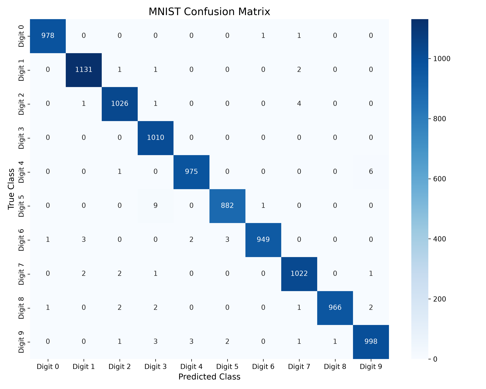
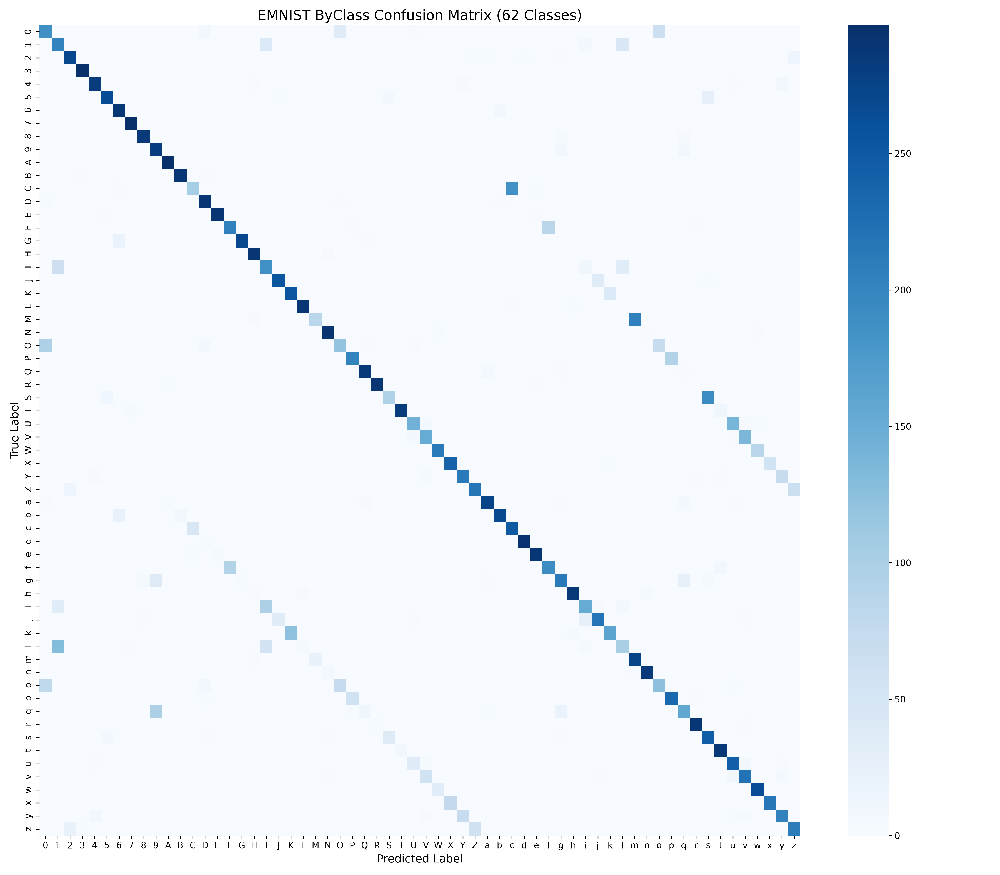

# Model Evaluation Report

Generated during test evaluation on 2 model(s).

## MNIST Model Performance

- **Test Accuracy**: `99.37%`
- **Test Loss**: `0.0222`

### Classification Report

```text
              precision    recall  f1-score   support

     Digit 0       1.00      1.00      1.00       980
     Digit 1       0.99      1.00      1.00      1135
     Digit 2       0.99      0.99      0.99      1032
     Digit 3       0.98      1.00      0.99      1010
     Digit 4       0.99      0.99      0.99       982
     Digit 5       0.99      0.99      0.99       892
     Digit 6       1.00      0.99      0.99       958
     Digit 7       0.99      0.99      0.99      1028
     Digit 8       1.00      0.99      1.00       974
     Digit 9       0.99      0.99      0.99      1009

    accuracy                           0.99     10000
   macro avg       0.99      0.99      0.99     10000
weighted avg       0.99      0.99      0.99     10000

```



---

## EMNIST Model Performance

- **Test Accuracy**: `1.45%`
- **Test Loss**: `4.1272`

### Classification Report

```text
              precision    recall  f1-score   support

           0       0.00      0.00      0.00        21
           1       0.00      0.00      0.00        24
           2       0.00      0.00      0.00        20
           3       0.00      0.00      0.00        14
           4       0.00      0.00      0.00        16
           5       0.00      0.00      0.00        14
           6       0.00      0.00      0.00        24
           7       0.00      0.00      0.00        18
           8       0.00      0.00      0.00        13
           9       0.00      0.00      0.00        25
           A       0.00      0.00      0.00        24
           B       0.00      0.00      0.00        30
           C       0.00      0.00      0.00        26
           D       0.00      0.00      0.00        18
           E       0.00      0.00      0.00        16
           F       0.00      0.00      0.00        21
           G       0.00      0.00      0.00        15
           H       0.00      0.00      0.00        20
           I       0.00      0.00      0.00        17
           J       0.00      0.00      0.00        18
           K       0.00      0.00      0.00        20
           L       0.00      0.00      0.00        25
           M       0.00      0.00      0.00        16
           N       0.00      0.00      0.00        23
           O       0.00      0.00      0.00        16
           P       0.00      0.00      0.00        26
           Q       0.00      0.00      0.00        26
           R       0.00      0.00      0.00        20
           S       0.00      0.00      0.00        20
           T       0.00      0.00      0.00        16
           U       0.00      0.00      0.00        17
           V       0.01      1.00      0.03        18
           W       0.00      0.00      0.00        22
           X       0.00      0.00      0.00        13
           Y       0.00      0.00      0.00        22
           Z       0.00      0.00      0.00        29
           a       0.00      0.00      0.00        21
           b       0.00      0.00      0.00        21
           c       0.00      0.00      0.00        23
           d       0.00      0.00      0.00        14
           e       0.00      0.00      0.00        21
           f       0.00      0.00      0.00        20
           g       0.00      0.00      0.00        21
           h       0.00      0.00      0.00        20
           i       0.00      0.00      0.00        21
           j       0.00      0.00      0.00        19
           k       0.00      0.00      0.00        19
           l       0.00      0.00      0.00        19
           m       0.00      0.00      0.00        14
           n       0.00      0.00      0.00        14
           o       0.00      0.00      0.00        23
           p       0.00      0.00      0.00        30
           q       0.00      0.00      0.00        22
           r       0.00      0.00      0.00        20
           s       0.00      0.00      0.00        23
           t       0.00      0.00      0.00        20
           u       0.00      0.00      0.00        19
           v       0.00      0.00      0.00        19
           w       0.00      0.00      0.00        20
           x       0.00      0.00      0.00        16
           y       0.00      0.00      0.00        24
           z       0.00      0.00      0.00        14

    accuracy                           0.01      1240
   macro avg       0.00      0.02      0.00      1240
weighted avg       0.00      0.01      0.00      1240

```



---

